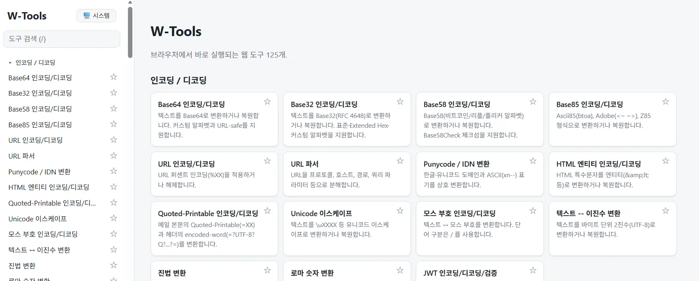
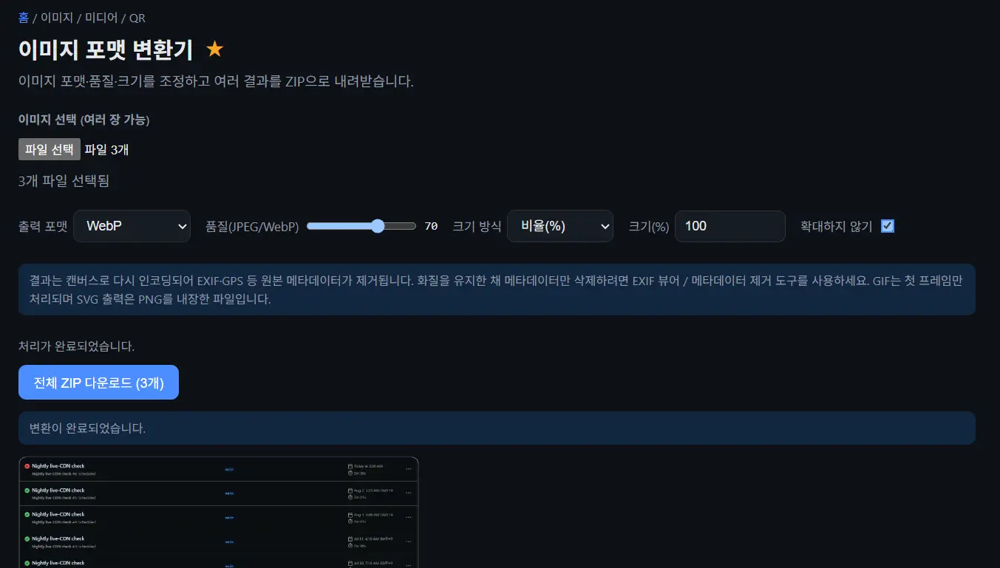
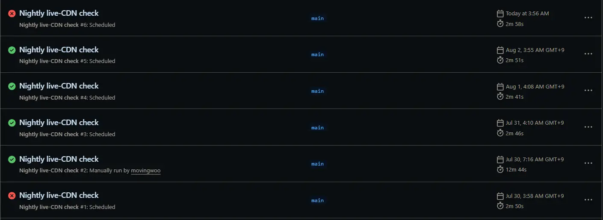
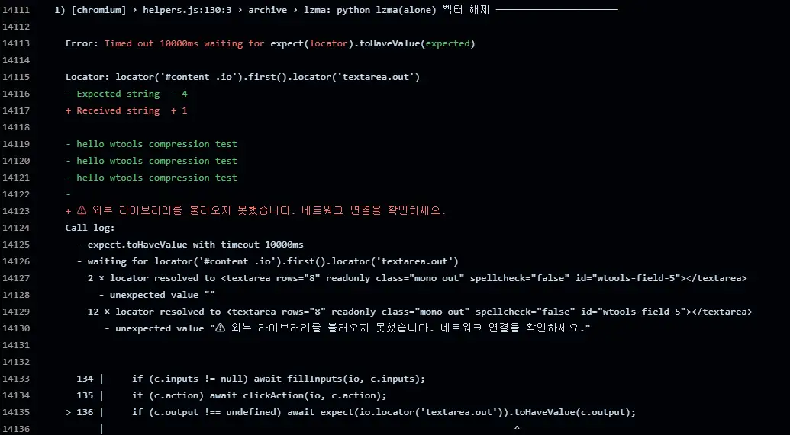

> #### 개요  
---  
  
favicon을 생성하거나 이미지 포맷을 변경하거나 base64 디코딩을 진행하거나  
작업을 할 때 외부 사이트를 이용하면서 나만의 사이트를 갖고 싶다는 작은 욕망이 있었다.  
때문에 와 를 참고하며 조금조금씩 개발을 하고 있었다.  
하지만 혼자 작업하는데 한계도 있고 언급한 두 소프트웨어가 너무나 뛰어나기 때문에 진척도는 지지부진한 상황.  
  
그런데 AI의 세상이 도래해버렸다.  
잊혀졌던 묵은 프로젝트를 끌어올려서 완성시켜버리자.  
  
> #### 설계  
---  
  
구현할 모든 기능은 할 수 있도록 한다.  
파일 업로드 시 파일이 서버로 전송되거나 하는 경우는 절대 없어야한다.  
예외가 하나 있다면, DNS 조회의 경우는 네트워크 조회 자체가 핵심이다.  
따라서 외부 통신이 반드시 필요한 도구 하나를 제외하면 전부 브라우저 내에서 처리한다.  
  
별도 빌드 없이 로 구현한다.  
순수 정적 사이트의 경우 github pages 무료 배포를 통해 서버 쌀먹이 가능하다.  
  
  
요즘들어 느끼는건데 PWA 설치 가능한 웹 앱이 범용성에서 최강인 것 같다.  
이놈의 네이티브 앱은 뭐 제한되는게 너무 많아가지고...  
  
> #### 구성  
---  
  
```markdown
index.html          # 진입점
css/
└── style.css       # 스타일
js/
├── core.js         # 도구 등록 프레임워크, 공통 UI 빌더, 유틸
├── main.js         # 해시 기반 라우터, 사이드바, 홈 화면
├── theme.js        # 테마
└── tools/*.js      # 카테고리별 모듈
assets/             # 아이콘
manifest.json       # PWA 매니페스트
sw.js               # 서비스워커
tests/              # Playwright 브라우저 테스트
scripts/            # 검증 스크립트
.github/workflows/  # github action 워크플로우
```
  
[WTools 기능명세서](https://raw.githubusercontent.com/movingwoo/wtools/refs/heads/main/FEATURES.md)  
  
> #### 실제 화면  
---  
  
[W-Tools](https://wtools.movingwoo.com/)  
  
[W-Tools - github](https://github.com/movingwoo/wtools)  
  
{: width="90%"}  
  
이 포스트에 넣을 사진도 포맷변환 기능을 이용하여 webp로 변환했다.  
  
{: width="70%"}  
  
png를 webp로, 품질 70%로 한번 삶아주면?  
github이 소화하는데 부담없는 용량으로 변한다!!  
  
> #### 고민거리  
---  
  
하다보니 지원 브라우저가 의외로 문제였다.  
어디까지 지원해야 하는거지?  
옛날 브라우저 지원을 고려할수록 사용할 수 있는 문법에 제한이 걸리기도 한다.  
  
처음엔 Object.hasOwn 문법을 기준으로 그 이후 문법은 사용하지 않게끔 했다.  
그런데 Argon2 알고리즘 기능을 추가하는 과정에 WebAssembly를 쓰려하니 지원 브라우저 버전이 올라가버렸다.  
이왕 이렇게 된 것 최소 지원버전을 올려버리고 버전 사이에 추가된 쓸만한 문법이 있으면 사용하는 방안을 고민 중이다.  
  
이게 어쨌든 도구의 집합체이기 때문에 도구의 기능 검증은 반드시 필요하다고 판단했다.  
github actions를 통해 스모크 테스트를 진행하는데 여기서 문제점 하나.  
CDN 라이브러리는 어떻게 검사를 할지?  
  
어쨋든 해당 라이브러리 연결에 문제가 생기면 내가 알아챌 수 있어야 하기 때문에 nightly workflow로 매일 새벽에 검사를 수행한다.  
  
{: width="70%"}  
  
{: width="70%"}  
  
그런데 이게 계속 실패를 한다?  
수동으로 돌린 #2를 제외하면 #1부터 #6까지 5번 스케쥴링 체크를 했는데  
5번 중 2번이 fail이다.  
  
로그를 확인해봐도 이건 진짜 그냥 통신 실패다.  
다시 돌려보면 정상 통신으로 성공한다.  
  
와 이건 어떻게 해결을 봐야할지 모르겠다.  
진짜 CDN 라이브러리가 유효한지 체크를 하려는건데 통신실패를 묻고 넘기는 것도 좀 아닌 것 같고  
실패하면 시간 두고 그냥 다시 돌리게 해야하나?  
