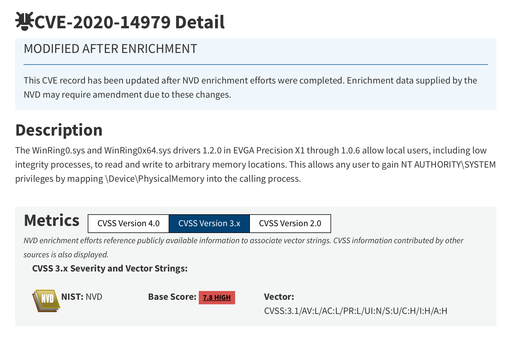

> #### 개요  
---  
  
[하드웨어 모니터](https://arc.movingwoo.com/development/python/2025/06/09/Hardware-Monitor.html)  
  
예전에 만든 하드웨어 모니터.  
turing-smart-screen을 이용해 구현했다.  
그런데 언제부턴가 이놈, 심각한 이슈가 있었다.  
이 녀석이  커널드라이버를 써가지고 허구헌날 윈도우디펜더한테 차단먹는다.  
그동안 오진할때마다 해제해줬는데 1년동안 그렇게 비볐으면 충분히 할만큼 했다.  
직접 개발 드가자.  
  
> #### 원인 분석  
---  
  
[CVE-2020-14979](https://nvd.nist.gov/vuln/detail/CVE-2020-14979)  
  
{: width="60%"}  

이것 말고도 CVE가 더 있긴한데 아무튼.  
대충 취약한 드라이버라고 한다.  
 권한상승 취약점이 다수 보고되었다.  
해커가 administrator 권한을 차지한다면? 으악 무셔!  
  
turing smart screen 프로젝트에서 하드웨어 온도를 재는 기능이 있다.  
온도를 재기 위해서 을 사용한다.  
여기서 CPU 온도를 읽기 위해 WinRing0 드라이버를 사용하고, 드라이버 자체는 위험하지 않고 정상적이다.  
단지 권한이 좀 쎄고 인간에게는 악의가 가득할 뿐임...  
  
사실 turing smart screen도 그래서 바뀌었다!  
WinRing0 드라이버를 오픈소스인  드라이버로 교체했다.  
대체 언제한건지 찾아보니까 올해 1월에 처리된 내용이다.  
난 그것도 모르고 꾸역꾸역 디펜더와 사투를 벌이고 있었다.  
  
> #### 구현  
---  
  
아무튼 간에 Pawn.IO를 쓰면 해결된다는 걸 알았고  
테마도 간단하니 대충 필요없는 라이브러리 들어내고 AI에 넣어서 한 번 빨면 나만의 가벼운 미니 스크린이 탄생하겠다.  
  
Windows 환경에서는 winget으로 Pawn.IO를 설치한다.  
  
```shell
winget install --id namazso.PawnIO
```
  
온도를 잘 받아오는지 확인하기위해 간단한 파이썬 스크립트를 작성한다.  
  
```python
def __init__(self, dll_dir: Optional[Path]):
    self._cpu_hardware = None
    self._sensor_type = None
    self.error: Optional[str] = None

    if dll_dir is None:
        self.error = "lhm 폴더가 지정되지 않음"
        return

    dll = Path(dll_dir) / "LibreHardwareMonitorLib.dll"
    if not dll.exists():
        self.error = f"{dll} 없음"
        return

    try:
        self._open(dll)
    except Exception as exc:
        self.error = f"초기화 실패: {exc}"
```
  
LibreHardwareMonitorLib.dll을 호출한다.  
어?? Pawn.IO를 써야하는데??  
사실 python에서 직점 해당 라이브러리를 호출하는게 아니라  
LibreHardwareMonitor 라이브러리에서 Pawn.IO를 통해 하드웨어 센서에 접근하는 방식이다.  
  
```text
movingwoo/miniscreen
│
├ sensors.py
│    └─ Hardware.Computer.Open()
│
└ lhm/
     └ LibreHardwareMonitorLib.dll
          │
          │ DLL 내부 코드
          ▼
     LibreHardwareMonitorLib/PawnIo/PawnIo.cs
          │
          ├─ CreateFile("\\?\GLOBALROOT\Device\PawnIO")
          └─ DeviceIoControl(...)
                    │
                    ▼
             PawnIO.sys
```
  
LibreHardwareMonitorLib.dll 내부에 PawnIo.cs가 내장되어있다.  
그래서 해당 dll을 통해 온도 측정을 호출 하면 된다.  
  
```python
from pathlib import Path

import psutil

from sensors import LibreHardwareMonitor

lhm = LibreHardwareMonitor(Path(__file__).parent / "lhm")

print(f"논리 코어 {psutil.cpu_count(True)} / 물리 코어 {psutil.cpu_count(False)}")
print(f"LHM 사용 가능: {lhm.available}  오류: {lhm.error}")

if lhm.available:
    lhm._cpu_hardware.Update()
    print(f"하드웨어 이름: {lhm._cpu_hardware.Name}")
    print("--- 센서 목록 ---")
    for sensor in lhm._cpu_hardware.Sensors:
        if sensor.SensorType == lhm._sensor_type.Temperature:
            print(f"  [온도] {sensor.Name} = {sensor.Value}")
    print(f"--- 선택된 값: {lhm.temperature()} ---")
```
  
테스트 코드를 짜서 온도가 잘 나오는지 확인해본다.  
대충 45도 언저리로 나오더라.  
정상적으로 동작한다는 뜻이다.  
  
> #### 끝  
---  
  
그렇다.  
뭔가 먼 길을 돌아온 것 같은데  
  
그냥 turing smart screen 업뎃만 할걸 그랬나...  
  
[miniscreen - github](https://github.com/movingwoo/miniscreen)  
  
일단 깃헙에 올린다.  
나중에 좀 더 범용성 있게 수정할 수 있으려나?  
급한 프로젝트는 아니다.  
  
turing smart screen 자체가 GPL3.0 라이선스였다.  
아무생각없이 MIT 라이선스 썼다가 GPL 라이선스로 변경.