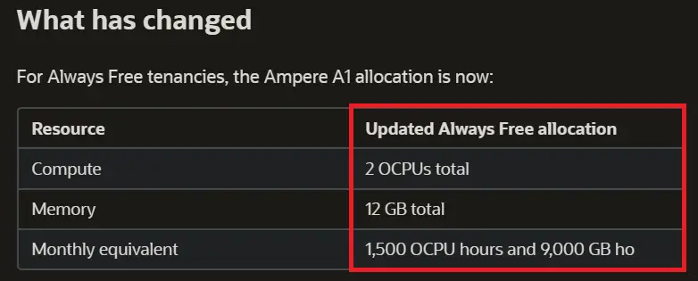
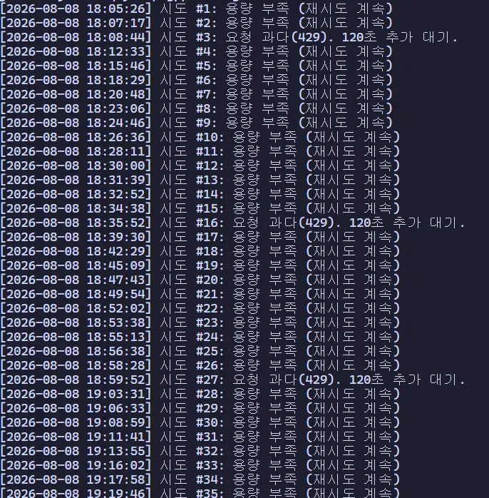
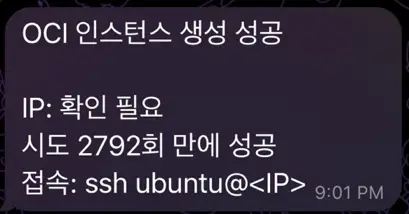
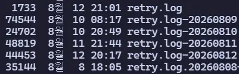
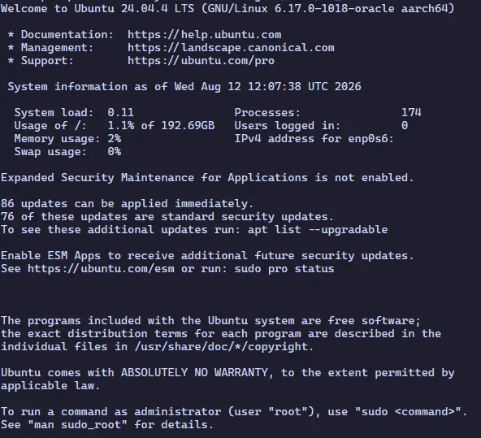

> #### 2호기 서버 이야기  
---  
  
국제미아가 된 2호기 서버  
어떻게 된 일이냐?  
  
오라클 클라우드가 4CPU 24GB 메모리를 뿌리던 미친 혜자 시절  
도쿄 리전에 서버를 두고 사용하고 있었다.  
  
그런데 아무래도 해외 리전보다 국내 리전에 두고 사용하고 싶어서 고객센터에 문의  
  

&nbsp;&nbsp;&nbsp;&nbsp;&nbsp;&nbsp;&nbsp;&nbsp;&nbsp;&nbsp;&nbsp;&nbsp;&nbsp;&nbsp;&nbsp;&nbsp;&nbsp;&nbsp;&nbsp;&nbsp;&nbsp;&nbsp;&nbsp;&nbsp;&nbsp;&nbsp;&nbsp;&nbsp;&nbsp;&nbsp;&nbsp;&nbsp;&nbsp;&nbsp;&nbsp;&nbsp;&nbsp;&nbsp;&nbsp;&nbsp;&nbsp;&nbsp;&nbsp;&nbsp;&nbsp;&nbsp;&nbsp;&nbsp;&nbsp;&nbsp;&nbsp;&nbsp;&nbsp;&nbsp;  
  
&nbsp;&nbsp;&nbsp;&nbsp;&nbsp;&nbsp;&nbsp;&nbsp;&nbsp;&nbsp;&nbsp;&nbsp;&nbsp;&nbsp;&nbsp;&nbsp;&nbsp;&nbsp;&nbsp;&nbsp;&nbsp;&nbsp;&nbsp;&nbsp;&nbsp;&nbsp;&nbsp;&nbsp;&nbsp;&nbsp;&nbsp;&nbsp;&nbsp;&nbsp;&nbsp;&nbsp;&nbsp;&nbsp;&nbsp;&nbsp;&nbsp;&nbsp;&nbsp;&nbsp;&nbsp;&nbsp;&nbsp;&nbsp;&nbsp;&nbsp;&nbsp;&nbsp;&nbsp;&nbsp;  
  
  

안되는건 안되는 거니 아쉬운대로 다른 방법을 궁리해보았다.  
  

&nbsp;&nbsp;&nbsp;&nbsp;&nbsp;&nbsp;&nbsp;&nbsp;&nbsp;&nbsp;&nbsp;&nbsp;&nbsp;&nbsp;&nbsp;&nbsp;&nbsp;&nbsp;&nbsp;&nbsp;&nbsp;&nbsp;&nbsp;&nbsp;&nbsp;&nbsp;&nbsp;&nbsp;&nbsp;&nbsp;&nbsp;&nbsp;&nbsp;&nbsp;&nbsp;&nbsp;&nbsp;&nbsp;&nbsp;&nbsp;&nbsp;&nbsp;&nbsp;&nbsp;&nbsp;&nbsp;&nbsp;&nbsp;&nbsp;&nbsp;&nbsp;&nbsp;&nbsp;&nbsp;  
&nbsp;&nbsp;&nbsp;&nbsp;&nbsp;&nbsp;&nbsp;&nbsp;&nbsp;&nbsp;&nbsp;&nbsp;&nbsp;&nbsp;&nbsp;&nbsp;&nbsp;&nbsp;&nbsp;&nbsp;&nbsp;&nbsp;&nbsp;&nbsp;&nbsp;&nbsp;&nbsp;&nbsp;&nbsp;&nbsp;&nbsp;&nbsp;&nbsp;&nbsp;&nbsp;&nbsp;&nbsp;&nbsp;&nbsp;&nbsp;&nbsp;&nbsp;&nbsp;&nbsp;&nbsp;&nbsp;&nbsp;&nbsp;&nbsp;&nbsp;&nbsp;&nbsp;&nbsp;&nbsp;  
&nbsp;&nbsp;&nbsp;&nbsp;&nbsp;&nbsp;&nbsp;&nbsp;&nbsp;&nbsp;&nbsp;&nbsp;&nbsp;&nbsp;&nbsp;&nbsp;&nbsp;&nbsp;&nbsp;&nbsp;&nbsp;&nbsp;&nbsp;&nbsp;&nbsp;&nbsp;&nbsp;&nbsp;&nbsp;&nbsp;&nbsp;&nbsp;&nbsp;&nbsp;&nbsp;&nbsp;&nbsp;&nbsp;&nbsp;&nbsp;&nbsp;&nbsp;&nbsp;&nbsp;&nbsp;&nbsp;&nbsp;&nbsp;&nbsp;&nbsp;&nbsp;&nbsp;&nbsp;&nbsp;  
  
&nbsp;&nbsp;&nbsp;&nbsp;&nbsp;&nbsp;&nbsp;&nbsp;&nbsp;&nbsp;&nbsp;&nbsp;&nbsp;&nbsp;&nbsp;&nbsp;&nbsp;&nbsp;&nbsp;&nbsp;&nbsp;&nbsp;&nbsp;&nbsp;&nbsp;&nbsp;&nbsp;&nbsp;&nbsp;&nbsp;&nbsp;&nbsp;&nbsp;&nbsp;&nbsp;&nbsp;&nbsp;&nbsp;&nbsp;&nbsp;&nbsp;&nbsp;&nbsp;&nbsp;&nbsp;&nbsp;&nbsp;&nbsp;&nbsp;&nbsp;&nbsp;&nbsp;&nbsp;&nbsp;  
  
  
  
  
  

저 상담원 말만 믿고 삭제 진행했는데  
계정이 산 것도 죽은 것도 아닌 이상한 좀비상태에 돌입해버렸다.  

오라클 클라우드 로그인 시 테넌트를 입력 후 테넌트가 존재하면 ID / PW 로그인을 진행하는데  
테넌트는 존재해서 들어가지는데 계정 입력시 없는 계정이라는 내용  
  
심지어 이 상황에서 로그인이 안되는 상황이라 고객센터에 문의도 불가능하다!!!  
그렇게 2호기 서버는 미아가 되었고 2년 가량 시간이 흘렀다.  
  
> #### 외국 서버가 필요함  
---  
  
요즘에 외국 서버가 간절히 필요해졌다.  
대형 VPN 초기 이벤트 체리 피킹하다보니 이제 끝이 다가오는데  
언제까지 VPN을 돈내고 써야하나?  
VPN도 쌀먹하려면 외국서버에 exit node를 둬야한다.  
  
문득 2호기가 그리워져 오라클 클라우드를 다시 두드려보았다...  
어? 테넌트가 제대로 사라진듯?  
완전 삭제까지 2년이 걸렸다.  
  
> #### 재가입 후 서버 생성 자동화  
---  
  
위에서도 언급했지만 오라클 클라우드는 진짜 미친 것 처럼 4CPU 24GB Memory 서버를 무료로 뿌렸다.  
근데 지들도 이게 미친 짓이란걸 드디어 알아챘나보다.  
  
[OCI Always Free: Updated Ampere A1 Compute Allocation](https://community.oracle.com/CustomerConnect/discussion/970310/oci-always-free-updated-ampere-a1-compute-allocation)  
  
{: width="70%"}  
  
  
  
얘 아니면 이만큼 주는게 없는걸  
  
아무튼 이번엔 오사카 리전으로 가입했다.  
예전에도 경험해보았지만 무료 인스턴스는 수동으로 생성하는게 불가능하다고 보면 된다.  
따라서 를 짜야한다.  
  
##### 1. 기본 정보 확인  
  
리전은  하나이다.  
나도 만들고서야 알았는데 오사카는 AD가 1개 뿐이라 더 빡세다...  
이럴 줄 알았으면 다시 도쿄로 돌아갔지  
  
셰이프는  로 하고  로 한다.  
부트 볼륨은  까지가 무료다.  
이미지는 우분투가 제일 만만하니  로 설정.  
  
기본 90초 단위로 계속 시도하다가 성공 시 텔레그램으로 알람을 받게 한다.  
환경 설정 파일 작성  
  
```ini
# OCI 인스턴스 재시도 스크립트 설정
# 텔레그램
TELEGRAM_BOT_TOKEN="봇토큰"
TELEGRAM_CHAT_ID="챗아이디"

# OCI 설정
COMPARTMENT_ID="ocid1.tenancy.oc1..xxxxxxxxxxxxxx"
AVAILABILITY_DOMAIN="xxxx:AP-OSAKA-1-AD-1"
SUBNET_ID="ocid1.subnet.oc1.ap-osaka-1.xxxxxxxxxxxxxxx"

# 인스턴스
DISPLAY_NAME="ubuntu-a1-osaka"
SHAPE="VM.Standard.A1.Flex"
OCPUS=2
MEMORY_GB=12
BOOT_VOLUME_GB=200

# 이미지
IMAGE_OS="Canonical Ubuntu"
IMAGE_OS_VERSION="24.04"

# 키 파일
SSH_PUBLIC_KEY_FILE="$HOME/.ssh/pubkey.pub"
```
  
##### 2. 자동화 스크립트 작성  
  
고려해야할 점은 다음과 같다.  
- 실패 알림을 다 받을 필요 없으므로 성공 하면 텔레그램으로 던지고 스크립트 종료  
- 너무 자주 호출 시 가 떨어지는데 429 발생 시 더 호출하지 않고 잠시 쉬었다가 호출  
- 백오프 시간은 천천히 감쇠하며 간보다가 429 발생하면 다시 쉬어주기  
  
대충 코어 스크립트는 이렇다.  
  
```shell
#!/bin/bash
# OCI 인스턴스 자동화 스크립트

# 텔레그램 알림
notify() {
  local title="$1" body="$2"

  if [[ -n "$TELEGRAM_BOT_TOKEN" && -n "$TELEGRAM_CHAT_ID" ]]; then
    curl -sS -m 20 -X POST "https://api.telegram.org/bot${TELEGRAM_BOT_TOKEN}/sendMessage" -d chat_id="$TELEGRAM_CHAT_ID" -d text="${title}"$'\n\n'"${body}" >/dev/null || log "WARN: 텔레그램 전송 실패"
  fi

  osascript -e "display notification \"${body//\"/\'}\" with title \"${title//\"/\'}\" sound name \"Glass\"" 2>/dev/null || true
}

# 중략

while true; do
  
  output="$(oci --no-retry --connection-timeout 20 --read-timeout 60 \
    compute instance launch \
    --availability-domain "$AVAILABILITY_DOMAIN" \
    --compartment-id "$COMPARTMENT_ID" \
    --shape "$SHAPE" \
    --shape-config "{\"ocpus\":${OCPUS},\"memoryInGBs\":${MEMORY_GB}}" \
    --image-id "$IMAGE_ID" \
    --subnet-id "$SUBNET_ID" \
    --boot-volume-size-in-gbs "$BOOT_VOLUME_GB" \
    --assign-public-ip true \
    --display-name "$DISPLAY_NAME" \
    --metadata "{\"ssh_authorized_keys\":\"${SSH_KEY}\"}" \
    2>&1)"

  rc=$?

  if [[ $rc -eq 0 ]]; then
    
    notify "OCI 인스턴스 생성 성공 IP: ${public_ip:-확인 필요} 시도 ${attempt}회 만에 성공 접속: ssh ubuntu@${public_ip:-<IP>}"
    exit 0
  fi

  # 실패 시 429 발생 시 잠시 쉬어주고 천천히 감쇠하는 식으로
  if grep -qiE 'out of (host )?capacity' <<<"$output"; then
    backoff=$(( backoff * 3 / 4 ))
    (( backoff < 15 )) && backoff=0
    log "시도 #${attempt}: 용량 부족 (재시도 계속)"

  elif grep -qiE 'TooManyRequests|429|rate limit' <<<"$output"; then
    backoff=$(( backoff == 0 ? 120 : backoff * 2 ))
    (( backoff > MAX_BACKOFF )) && backoff=$MAX_BACKOFF
    log "시도 #${attempt}: 요청 과다(429). ${backoff}초 추가 대기."

done
```
  
##### 3. 로그 확인 및 기도  
  
{: width="60%"}  
  
429가 중간중간 뜨지만 이정도면 아주 안정적이다.  
이제 부엌에 가서 깨끗한 그릇에 생수 떠넣고 기도하면 된다.  
  
> #### 결과  
---  
  
어느날 21시 경 텔레그램이 울렸다.  
  
{: width="20%"}  
  
오우 이게 무슨 소리야  
겨우 2792회 만에 성공하다니이이잇  
사실 실제 시도 횟수는 3000회가 넘었을 것이다.  
카운트를 나중에 찍어가지고...  
  
{: width="30%"}  
  
대충 5일 걸린 것 같다.  
역할을 다한 이 스크립트는 그대로 폐기한다.  
다시는 쓸 일이 없기를 바란다.  
  
{: width="50%"}  
  
키 파일로 ssh 로그인 성공.  
  
6고오키가 탄죠오시타.  
코이츠, 키메라레타 시고토가 아루...  