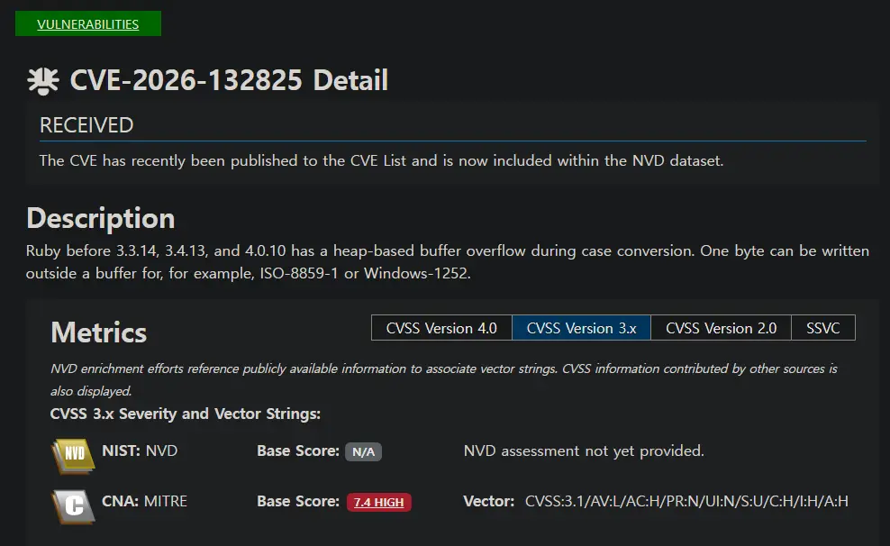
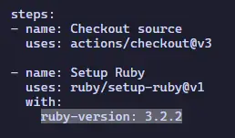
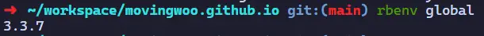
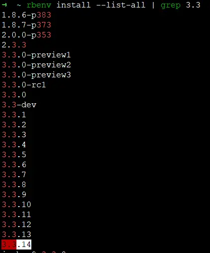
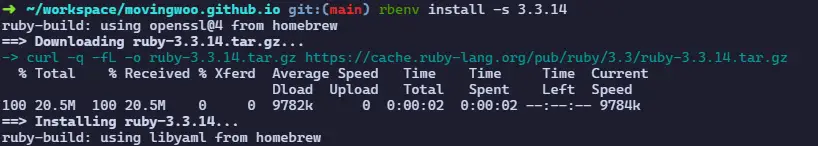
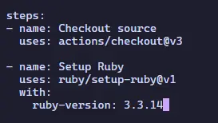
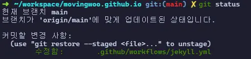
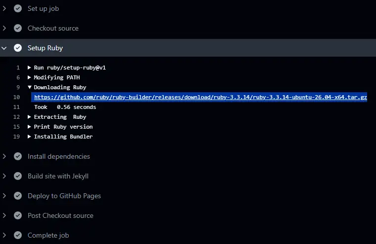

> #### AI 멈춰!!  
---  
  
AI가 취약점을 마구마구 파헤치고 있다.  
 부터 시작해서 까지  
매일매일 새로운 취약점이 쏟아진다.  
제발 멈춰 AI야 왜 일거리를 줄이는게 아니라 늘리는 거니...  
  
다행히도 개인적으로 운영 중인 대부분의 서비스는 취약점의 영향에서 빗겨가있다.  
설령 취약점이 있다고 하더라도 웬만하면 오픈소스 프로젝트를 이용하기 때문에 딸깍 업데이트 방안이 다 마련되어있다.  
  
그런 와중에 정말 안타깝게도 새로운 취약점이 나왔는데...  
  
> #### Ruby2Shell  
---  
  
[CVE-2026-132825](https://nvd.nist.gov/vuln/detail/cve-2026-132825)  
  
{: width="80%"}  
  
루비에 터진  취약점.  
대충 문자열 대소문자 변환할 때 버퍼 밖에 1바이트를 써서 그 놈이 문제라는 것이다.  
이 jekyll 블로그가 ruby를 사용한다.  
  
사실 PHP2Shell 때도 느꼈지만  
취약점은 취약점인데 조건이 너무 까다롭다.  
이걸로 어떻게 해킹하는거지? 난 전문가가 아니라 모르겠다.  
  
난리난리를 피워서 업데이트를 미리 하려했다가 귀찮아서 내버려두고 있었다.  
바빠 죽겠는데 겨우 이정도 규모 블로그에 신경 쓸 틈이 없었다.  
그래도 이제 잠깐 시간이 난 김에 업데이트나 해버리자.  
  
> #### 현황 점검  
---  
  
{: width="20%"}  
  
github 배포 설정 확인해보니 버전이 설치되어있다.  
좀 낡긴 했다.  
  
{: width="40%"}  
  
개발 환경 전역 설정은 3.3.7이다.  
CVE 상세 내역을 보면  버전은 무사하다고 하니까 개발환경을 3.3.14로 올리고 github에도 해당 버전을 따라가도록 설정하자.  
  
##### 1. 3.3.14 설치  
  
요즘 개발은 웬만하면 mac 환경에서 진행하고 있다.  
rbenv를 이용해 버전을 관리하므로  명령어로 3.3.14 버전이 있는지 확인해본다.
  
{: width="30%"}  
  
타겟 버전 확인 완료.  
업데이트 후 global 설정을 3.3.14로 맞춰준다.  
  
```shell
rbenv install -s 3.3.14
rbenv global 3.3.14
```
  
{: width="70%"}  
  
bundle install과 bundle exec jekyll build로 이상 없는지 확인하면 완료.  
  
##### 2. 배포 설정 변경 및 커밋
  
에서 실제 github actions에 배포할 버전을 설정한다.  
  
{: width="20%"}  
  
커밋하면 변경사항은 딱 이 파일 하나 뿐이다.  
  
{: width="40%"}  
  
push 후 정상적으로 배포되는지 확인하면 끝이다.  
  
{: width="70%"}  
  
> #### 마무리  
---  
  
내 서버는 내가 개조하고 배포해서 업데이트가 편하다.  
그런데 한국 IT 특유의 누가 개발한지도 알 수 없고 어떻게 운영 중인지도 모르는 원시 고대 사이트들은 업데이트도 쉽지 않다.  
AI님이 숨어있는 취약점을 전부 뚫어주시는 은총을 베푸시메 모두가 고통받고 있다.  
제발 그만해!!!  
  
그래도 희망적인 관측을 보이자면  
AI가 발견하는 취약점들은 대부분 오래되었지만 공격방식이 너무나 복잡해 실현 가능성이 낮은 경우가 대부분으로 보인다는 것이다.  
그래서 아무도 모르게 묵혀있던 것으로 보이기도 하고  
한 번 취약점 싹 정리하고 나면 평화가 찾아오지 않을까 생각한다.  
아 쉬고싶어라  