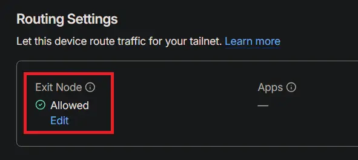
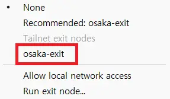
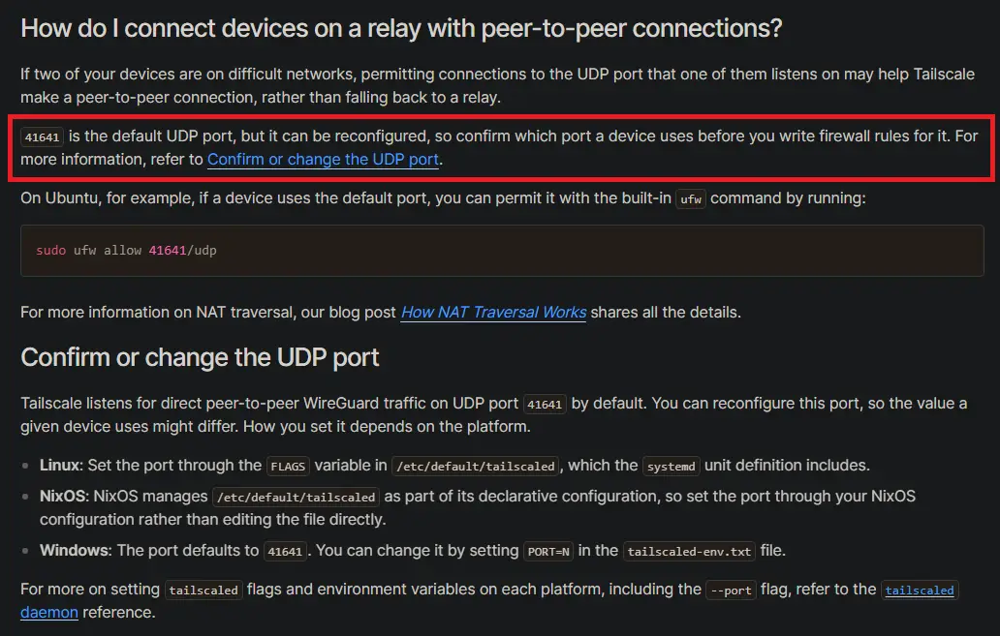
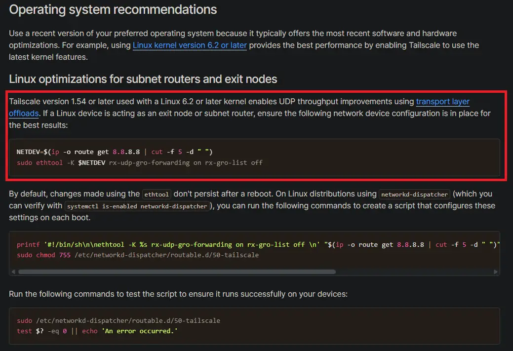

> #### 개요  
---  
  
해외 VPS가 존재하면 그쪽으로 인터넷 트래픽을 라우팅해 외부에 노출되는 IP를 변경할 수 있다.  
일반 사용자들이 생각하는 VPN의 기능이다.  
그리고 나는 일본에 6호기가 존재한다.  
말인즉슨, 이 가능한 것이다!  
  
> #### Tailscale Exit Node  
---  
  
대충 6호기에 테일스케일 올리고 계정에 등록해주는 절차는 생략.  
  
Exit Node는 다른 장비의 패킷을 받아야해서 을 활성화한다.
  
```shell
echo 'net.ipv4.ip_forward = 1' | sudo tee -a /etc/sysctl.d/99-tailscale.conf
echo 'net.ipv6.conf.all.forwarding = 1' | sudo tee -a /etc/sysctl.d/99-tailscale.conf

sudo sysctl -p /etc/sysctl.d/99-tailscale.conf
```
  
그리고 VPS가 Exit Node 역할을 제공한다고 advertise 한다.  
  
```shell
sudo tailscale set --advertise-exit-node
```
  
어드민 콘솔로 들어가서 해당 서버를 Exit Node로 등록해준다.  
  
{: width="40%"}  
  
이러면 우선 간단한 설정은 끝이다.  
  
{: width="30%"}  
  
딸깍만 하면 와타시와 니혼진 데스  
  
> #### 보완 작업  
---  
  
몇 가지 보완 작업을 해야한다.  
  
[What firewall ports should I open to use Tailscale?](https://tailscale.com/docs/reference/faq/firewall-ports)  
  
{: width="70%"}  
  
DERP 릴레이를 사용하면 속도와 지연시간이 조져질 수 있다.  
피어 투 피어 직접 통신을 위해 를 열어준다.  
  
[Performance best practices](https://tailscale.com/docs/reference/best-practices/performance#ethtool-configuration)  
  
{: width="70%"}  
  
UDP 처리량 향상을 위해  옵션을 활성화한다.  
이걸로 속도 관련 할 수 있는건 얼추 다 했다.  
  
> #### 남은 일  
---  
  
이 뚫리는지 테스트 해보면 된다.  
이딴게.... IT 강대국....?  
  
이제 이 해외 VPS를 끊기지않게 유지를 잘 해야하는데  
오라클 클라우드 특성 상 사용량이 부족하면 노는 줄 알고 가차없이 압수당할 염려가 있다!  
그에 대한 대책은 다음 기회에  
  
언젠가 테일스케일을 헤드스케일로 전환해야하는데 엄두가 안나네 하고 차일피일 미루고 있는데  
왜 서버가 또 하나 늘어나서 귀찮게 된건지  
어디 무료 쌀먹서버 하나 더 안튀어나오나 모르겠다.  